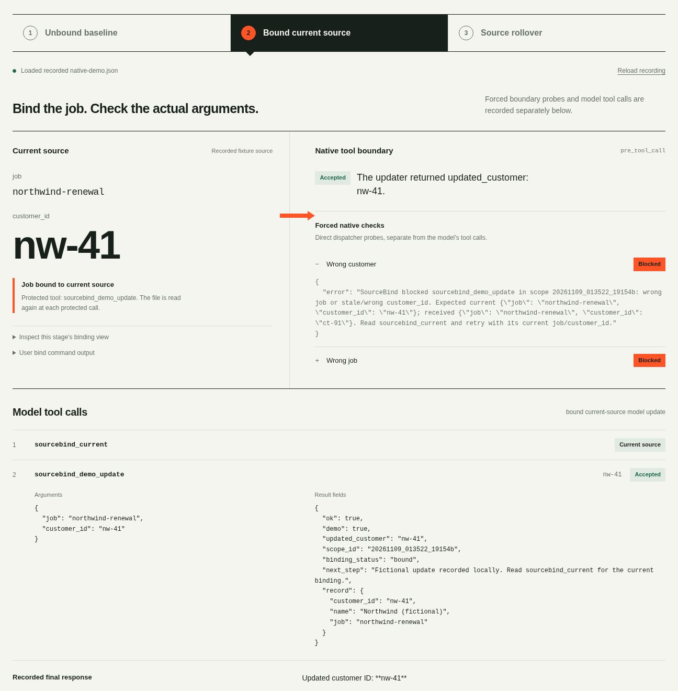

# SourceBind

Two valid customer IDs can both return success. A renewal job for Northwind can
still update Contoso. SourceBind binds an explicit job to its **current local
JSON source**, then checks the actual `job` and `customer_id` immediately before
one selected tool runs.

## Try it in 30 seconds

After installing, start Hermes from this checkout. The included
`examples/current-customer.json` contains:

```json
{"job":"northwind-renewal","customer_id":"nw-41"}
```

In Hermes:

```text
/sourcebind bind northwind-renewal examples/current-customer.json
/sourcebind status
```

Then send:

```text
For this fictional demo, first try sourcebind_demo_update with job
"northwind-renewal" and customer_id "ct-91". After that attempt, call
sourcebind_current and retry the update with its current job and customer_id.
```

The `ct-91` attempt is blocked before the update handler. Reading the current
source gives `nw-41`, whose update succeeds. Both IDs are valid in the fixture;
an unbound scope accepts either. Demo updates write fictional, profile-local
records. Payments and production service calls: **0**.

## Install

Requires **Hermes 0.23.0+**. From this checkout:

```sh
hermes plugins validate "$PWD" --install-deps
hermes plugins install https://github.com/blucca/hermes-sourcebind --no-enable
hermes plugins enable sourcebind
```

Restart Hermes after enabling. Plugin Python dependencies: **0**; the code uses
the standard library.

## Binding and current-source changes

| User command | Effect |
| --- | --- |
| `/sourcebind bind <job> <source.json> [protected_tool]` | Select the current source and one tool; default: `sourcebind_demo_update`. |
| `/sourcebind status` | Show the binding for this native scope. |
| `/sourcebind clear` | Clear this scope's active binding. |

The selected JSON must be an object with nonempty, top-level string fields
`job` and `customer_id`. Relative paths resolve from the working directory at
bind time; `~` and quoted paths with spaces work. The absolute path is stored.
The model-callable read interface is `sourcebind_current`; the other plugin
tool updates the fictional fixture. Binding changes use the user slash command.

For a source rollover, edit `customer_id` while keeping `job` unchanged. For
example, change Northwind’s current reference from `nw-41` to the also-valid
`nw-42`. The separate `ct-91` record belongs to Contoso. The guard rereads
the file at every protected call: the old ID is blocked and the new current ID
passes. A read, UTF-8, JSON, field-validation, or source-job failure blocks the
selected tool. Repairing the file restores the existing binding; choosing a
different job uses a fresh `bind`.

There is **one active binding per profile**. A new explicit bind replaces it.
Its scope follows the originating native session through the public
`subagent_start` and `post_compaction` events. Independently started sessions
retain their own scopes; a parent reference alone keeps that independence.

## Protect an existing tool

```text
/sourcebind bind northwind-renewal "/absolute/path/current source.json" crm_update
```

Choose an already-registered tool with top-level string arguments `job` and
`customer_id`. The check applies to that exact tool name and these two fields.
Selecting it replaces the default fixture as the protected target. Other tools,
arguments, backend effects, and Hermes approvals keep their existing contracts.

The selected file is the authority at call time. When shell or file tools have
write permission to it, those tools can change the authoritative values that
subsequent guarded calls read. Keep source-file write permissions aligned with
who may change the business mapping.

## Runtime disclosures

| Surface | Behaviour |
| --- | --- |
| Reads outside plugin data | The explicitly selected local business JSON, using the Hermes process's OS file permissions. Source-content fields exposed to the model: `job` and `customer_id`. |
| Stored data | Profile-scoped Hermes `ctx.state`: binding with absolute source path and scope, native scope aliases, and fictional demo records. `clear` removes the active binding. |
| Third-party network requests / telemetry | 0 plugin-initiated requests; 0 telemetry. |
| Shell commands / background processes | 0 plugin-initiated commands; 0 background processes. |
| Credentials | 0 requested or stored; 0 credential-store discovery. |
| Hermes extensions | Two tools, one user command, and public `pre_tool_call`, `pre_llm_call`, `subagent_start`, `post_compaction` hooks. |

`pre_tool_call` enforces the binding; `pre_llm_call` supplies scoped guidance.
The plugin uses public registration and state APIs.

## Native demonstration

[Watch the 71-second film](https://blucca.github.io/hermes-sourcebind/demo/#film)
or [download the MP4](demo/sourcebind-demo.mp4). The film includes English
captions and synthesized narration.

[Open the recorded native run](https://blucca.github.io/hermes-sourcebind/demo/)
— fictional customers, real Hermes tool calls.




The standalone `examples/native-demo.py` harness runs a real Hermes agent and
its native tool dispatcher. It uses your configured model, creates a fictional
source under `--output-dir`, and saves each observed step as `native-demo.json`.
Use a dedicated demo profile: this example sets an active SourceBind binding.

Run with the Hermes checkout's Python environment:

```sh
/path/to/hermes-agent/.venv/bin/python examples/native-demo.py \
  --hermes /path/to/hermes-agent --provider YOUR_PROVIDER --model YOUR_MODEL \
  --output-dir /path/to/your/workspace/temp/sourcebind-demo
```

The forced stale calls exercise the native execution boundary; the agent turns
use the configured model. The harness imports Hermes core for the demonstration;
the plugin entrypoint extends Hermes through the public `ctx` APIs.

Standard-library checks: `python3 tests/check.py` — 12 checks pass. Current
Hermes v0.23.0 validation passes, including the safe install scan. The observed
v0.1.1 native model run is saved in [demo/native-demo.json](demo/native-demo.json):

- Unbound: valid `ct-91` updates Contoso for the Northwind job.
- Bound: wrong customer/job calls stop; the model reads the selected source and
  updates `nw-41`.
- Source rollover: old `nw-41` stops; the model refreshes and updates `nw-42`.
- Broken JSON stops the protected call; repairing it restores a ready read.

The stock model uses discovery `tool_call` envelopes. The readout resolves the
actual business calls and retains the native envelopes alongside them. Forced
boundary checks and model calls are recorded separately.

AI-led development: Codex / blucca. Source and documentation: [MIT](LICENSE).
